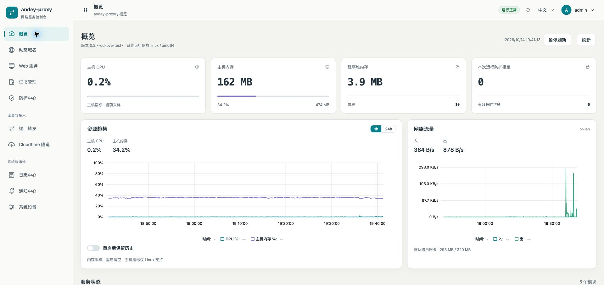
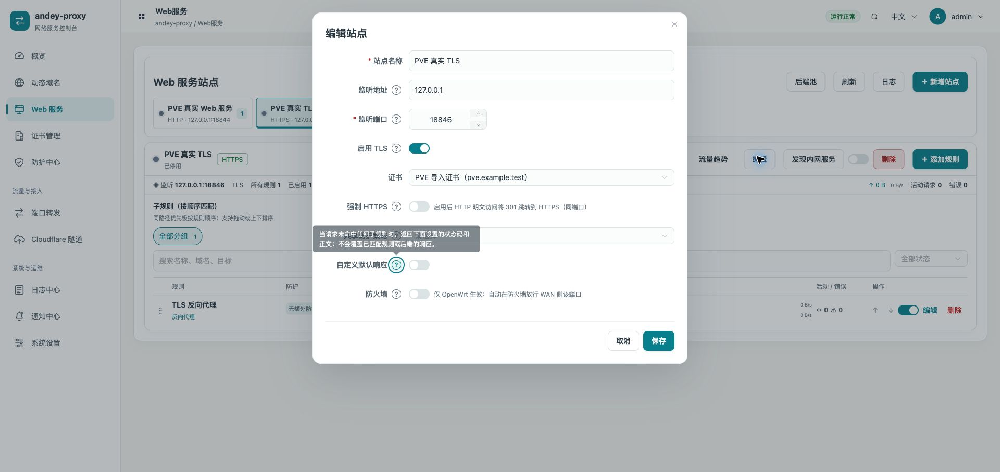

# UI/UX 配色与布局验收

2026-10-14。本轮已安装 `0.3.7-cd-pve-test7` 到 PVE 测试路由器 [192.168.199.7](https://192.168.199.7:16606/web-service)。未提交、推送或发布正式版本。

## 视觉与交互

| 层级 | 配色/处理 |
| --- | --- |
| 页面背景 | 暖灰 `#f3f3f0`，10 个工作区使用同一背景 |
| 内容表面 | 白色 `#ffffff` 卡片，细边框、轻阴影、统一圆角 |
| 主操作 | 青蓝 `#087f8c`，选中状态增加色块和侧边标记 |
| 文字 | 石墨 `#26343e`，系统中文字体；次级文字、标题和统计数字区分层级 |
| 图表 | 青蓝请求/入流量、绿色出流量、紫色内存；CSS 与 canvas 色板同步 |
| 控件 | 统一按钮、输入框、选择框、标签、焦点反馈；窄屏采用至少44px主要交互区域 |

导航使用同一套自绘 SVG 线条图标：仪表、地球、浏览器、证书印章、盾牌、双向箭头、云通道、日志页、通知铃、调节器。真实页面读取到10个菜单与10种不同SVG图形；展开和折叠均可导航，窄屏使用抽屉。

站点编辑将地址、端口分成两个字段。接口仍提交原有 `host:port` 配置；IPv6 自动补方括号，支持旧裸端口及空地址。旧站点停用状态、规则列表及修订号随保存保留。端口限制为整数1–65535。中文标签列160px，实机各行40px高，“自定义默认响应”不再换行或挤压防火墙行；窄屏标签和控件上下排列。

`HelpHint.vue` 提供问号说明，支持悬停、聚焦和点击，并使用不提交表单的按钮。覆盖监听地址/端口、TLS、强制HTTPS、共享策略、默认响应、防火墙、后端池、代理头、后端证书校验、认证、WebDAV写入、CORS、服务发现、WAF/CC、DDNS来源/回退、证书EAB。仅展示说明，不修改设置。弹窗正文独立滚动，标题与保存区保留在视口内。补充修复问号圆圈越过正文滚动容器、使整个弹窗产生额外滚动的问题；窄屏顶部留白统一为16px。手机顶部语言和账户菜单补充了可访问名称。

同时修复证书高级参数页使用未声明语言变量的问题，增加打开ACME高级表单的回归用例。

## 实测证据

- 前端22文件72项测试通过；包含旧监听配置往返、IPv6地址/端口分别修改、规则/状态/修订保留、说明按钮不提交表单、悬停提示和证书高级表单打开。
- 格式检查、生产构建通过。Linux amd64、arm64、armv7、mips、mipsle重新构建通过；本轮只有amd64在真实路由器运行。
- test6在真实路由器HTTPS浏览器逐页检查10个模块。原桌面1920px、浏览器窄屏390px两组均无整页横向溢出；宽表格允许在其容器内滚动。实体手机没有测试。
- test6真实TLS编辑窗口显示地址 `127.0.0.1`、端口 `18846` 与原导入证书；问号提示通过键盘打开验证。只打开并取消草稿，没有保存配置或启用站点。
- 原账号登录及13个认证只读接口通过。DDNS仍为原有3个停用任务，原2个停用站点和导入证书保留；网络、防火墙文件SHA256一致。
- 用户手动处理更新后的浏览器自签名证书警告后，完成真实页面验收。没有自动绕过浏览器安全提示。
- 系统设置的官方发布源检查出现访问受限提示，发布检查的外部连通性没有在本轮修复；其余UI验收结果与该提示分别记录。

测量文件：[真实路由器布局](screenshots/ui-2026-10-14/pve-layout-measurements.json)、[菜单图形验证](screenshots/ui-2026-10-14/navigation-verification.json)。本机隔离实例的测量位于同目录 `layout-measurements.json`，与真实路由器证据区分。

完整逐页截图位于 `screenshots/ui-2026-10-14/`：`pve-*.png` 为真实路由器，带 `-mobile` 表示浏览器390px宽度，其他文件为隔离实例。

## 最终修正验证状态

最终test7只新增问号圆圈的相对定位和窄屏16px顶部间距，避免长表单让外层弹窗产生滚动。72项前端测试、5架构构建及PVE13个认证接口已复查。本机390px完整TLS/默认响应表单：外层scrollTop=0、弹窗top=16px、保存区bottom=793px、页面宽度390px；正文独立滚动。对应截图为 `site-dialog-mobile-fixed.png`。用户处理证书提示后，最终test7的真实PVE长表单也已复核通过：外层scrollTop=0、正文scrollTop=382px、弹窗top=16px、保存区bottom=793px，正文宽度无溢出。结果见 `pve-site-dialog-mobile.json` 与 `pve-site-dialog-mobile.png`；概览截图已更新为test7。之前test6的故障证据标记为 `pve-site-dialog-mobile-before-fix.*`，没有混作修正结果。

## 安装与范围

二进制SHA256：`2d83eef55c98a5e2e74cb5c30017653aaa5c88b6441228160f91213c857b41ab`。构建、版本和接口明细见 [增量验证JSON](cd-web-validation-2026-10-14.json)。升级前test6二进制、配置、配套密钥及UCI已备份到 `/root/andey-proxy-test-backups/20261014-ui-test7/`；test5备份位于 `20261014-ui-test6/`。回退时恢复匹配的二进制、配置和密钥。

本轮是整体视觉和交互更新。C/D的GeoIP、TCP诱捕、跨设备证书同步、静态CNAME/TXT记录仍待开发；未进行真实云DNS写入、公网ACME签发或整机重启。
