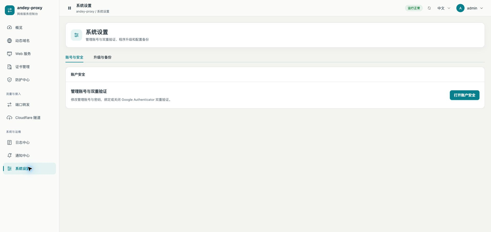
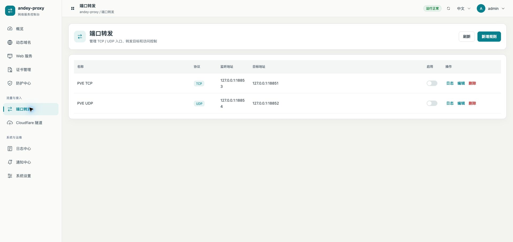

# 设置去重与五个工作区统一

2026-10-14，PVE测试机已安装 `0.3.7-cd-pve-test8`。

## 功能分工

| 页面 | 保留的功能 |
| --- | --- |
| 概览 | 系统运行信息、版本/架构、账户安全状态、防火墙放行状态、资源和流量图表 |
| 系统设置 | 账号与安全、签名包升级、配置备份和恢复 |
| 日志中心 | 筛选、实时刷新/暂停、导出、分页及受认证保护的清空 |
| 通知中心 | 通知渠道、事件订阅及最近通知事件 |
| 端口转发 | TCP/UDP规则、监听/目标、访问控制和日志入口 |
| Cloudflare隧道 | 环境、账号、隧道实例、运行状态和控制 |

设置页移除与概览重复的运行信息、防火墙状态卡片，以及重复的通知中心快捷入口。设置页不再为了这些卡片请求dashboard/system-info接口。账号安全入口继续使用原有布局提供的账号管理窗口；升级与备份组件保持原有功能和认证要求。

## UI

日志、通知、设置、端口转发、隧道共用 `WorkspaceHeader.vue`，采用相同图标容器、22px标题、13px说明、右侧操作区。桌面标题栏内边距20px，390px窄屏内边距12px，操作按钮自动换行。统一卡片标题、卡片间距、表格表面、按钮尺寸、弹窗滚动样式；内容布局按功能区分。

隧道空列表只显示一次空状态。配置表单、规则和通知事件的接口与业务逻辑不变，没有发送测试通知或修改业务配置。

## 验证

- 前端23文件74项通过，包含设置去重、账号管理入口和升级备份仍可进入的用例；格式检查、生产构建通过。
- 本机隔离实例五个页面均检查1280px/390px，整页没有横向溢出。测量见 `screenshots/workspaces-2026-10-14/local-measurements.json`。本机截图与PVE真实截图分别命名。
- 五种Linux架构重新构建通过；仅amd64在PVE运行。
- 原管理员登录以及21个认证只读接口通过，新增检查包括转发、隧道、通知、维护状态和日志接口；原3个DDNS任务、2个停用站点保留。
- 网络、防火墙文件SHA256保持原值。升级前test7二进制、配置、配套密钥和UCI备份在 `/root/andey-proxy-test-backups/20261014-workspace-test8/`。
- 用户处理证书提示后，五个页面均在PVE真实HTTPS浏览器完成桌面1920px与窄屏390px验收，整页无横向溢出；22px标题一致，桌面标题栏20px、窄屏12px内边距一致。设置重复卡片已确认不存在，升级与备份页仍可进入。实体手机没有测试。测量见 `screenshots/workspaces-2026-10-14/pve-measurements.json`。

新二进制SHA256：`786b19ea2b36c924603717ada84aeba0fbbac52c1cf3c5c9aa45231f8c7e0036`。未提交、推送或发布正式版本。没有改变之前C/D仍待开发项目的状态。

